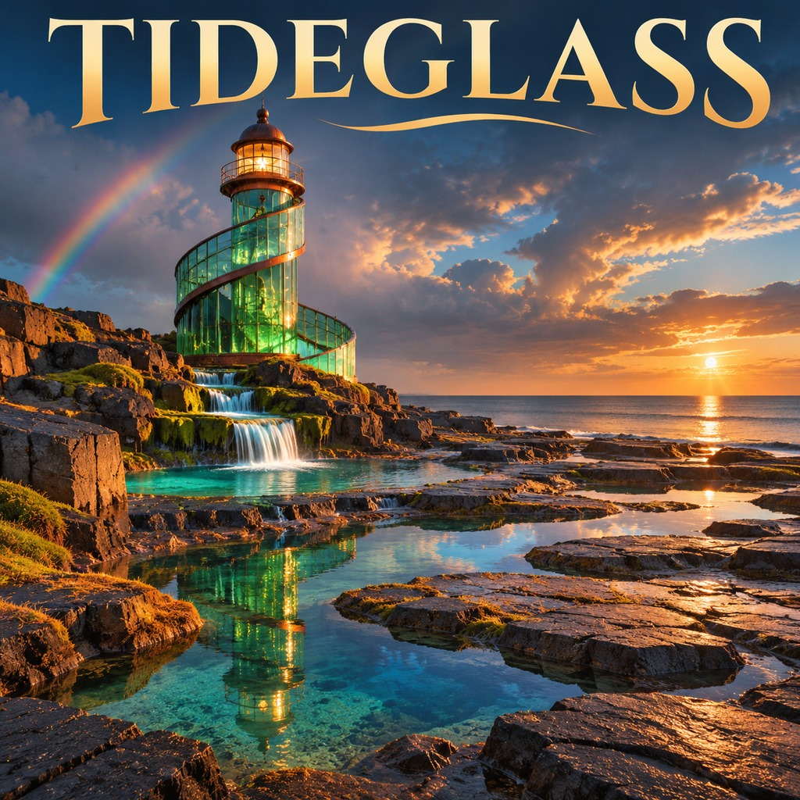

[](https://make.fun/bounty/the-poster-for-a-place-that-i-2-20261121-0539?utm_source=github&utm_medium=readme&utm_campaign=the-poster-for-a-place-that-i-2-20261121-0539)
[](https://make.fun/bounty/the-poster-for-a-place-that-i-2-20261121-0539/leaderboard?utm_source=github&utm_medium=readme&utm_campaign=the-poster-for-a-place-that-i-2-20261121-0539)
[](https://make.fun/bounty/the-poster-for-a-place-that-i-2-20261121-0539?utm_source=github&utm_medium=readme&utm_campaign=the-poster-for-a-place-that-i-2-20261121-0539)
[](https://make.fun/bounty/the-poster-for-a-place-that-i-2-20261121-0539)

# The Poster for a Place That Isn't There — Tideglass

A travel poster for the entirely fictional place Tideglass: a black-basalt tidal shelf at low tide, clear cobalt pools, and a green-glass spiral lighthouse wrapped around a freshwater spring. A rain shower has just passed; amber sunlight catches the glass and copper-warm rocks, with a calm sea at the horizon. The name TIDEGLASS, set large in gold at the top, is the only text in the image. The clear pools invite you to linger after the rain, then follow the amber-lit spiral toward the spring.



## Competition

Entry for make.fun's [the-poster-for-a-place-that-i-2-20261121-0539 bounty](https://make.fun/bounty/the-poster-for-a-place-that-i-2-20261121-0539), **"The Poster for a Place That Isn't There"**.

- **Prize pool:** $50; free entry; top 20 paid.
- **Deadline:** 21 November 2026 15:39 WIB.
- **Judge:** `glm-5.3-flash`, acting as a travel-poster art director.

Criteria, in order:

1. A travel poster for a place that does not exist, with the invented name set into the picture.
2. Makes you want to go.
3. A distinct identity.
4. Type set with intent.
5. Colour and composition that sell the place.

## Run

Requires **Node.js 22.18+**, using native TypeScript execution. There are no dependencies to install and the program makes no network calls.

```sh
node main.ts
```

Or run `npm start`. By default, the program creates `/output` if needed and writes `/output/entry.png`. To choose another directory:

```sh
MAKEFUN_OUTPUT_DIR=/tmp/tideglass-output node main.ts
```

The source path is resolved from the script's own directory with `fileURLToPath(import.meta.url)`, so the program can also be invoked by absolute path from another working directory. A relative `MAKEFUN_OUTPUT_DIR` is resolved from that same script directory.

The program copies `source-image.jpg` byte-for-byte, then reads back the written file and validates its JPEG markers and header dimensions: **JPEG**, exactly **1024×1024 pixels**, and at most **1,048,576 bytes**. It also checks that the written bytes equal the source and throws a clear error on failure. Its success line reports the output path, byte size, and SHA-256. The required filename is `entry.png`; its contents remain the original JPEG, with no conversion, cropping, or re-rendering.

Verified `entry.png`:

- **Byte size:** 393,140 bytes.
- **SHA-256:** `7df58959975cb6e06280d916f2f77951f08570bb94c26250bdbdf009bc75b9b5`.

Verification ran the program into two different output directories, including an invocation from another working directory. `sha256sum` and `cmp` confirmed both outputs are byte-identical to each other and to `source-image.jpg`, and both satisfy the size limit.

Built for make.fun. Referral link: https://make.fun/r/p8atzycs
